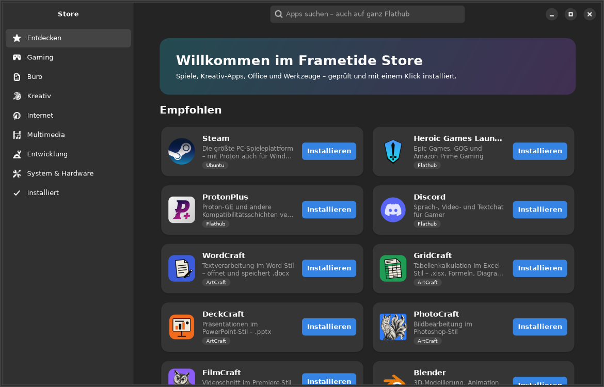

<sub>🇬🇧 [English version](README.md)</sub>

# Frametide OS 1.0 „Ignition“

> **Status: Alpha.** Frametide OS ist ein unabhängiges Community-Projekt und steht in keiner
> Verbindung zu Canonical (Ubuntu), Valve (Steam), Google, Microsoft oder dem ArtCraft-Team.
> Alle Marken gehören ihren jeweiligen Inhabern. Bitte zuerst in einer VM oder auf einem
> Testrechner ausprobieren.


Eine Gaming-Distribution auf Basis von **Ubuntu 26.04 LTS** (Updates bis 2031)
mit GNOME. Die Ziele, nach Priorität:

1. **Volle Gaming-Leistung** durch automatisch passend eingerichtete Treiber
2. **Schneller Start und schnelle, einfache Installation**
3. **Minimalistisches, ruhiges Design** bei Optik und Klang

## Was Frametide anders macht als Ubuntu

| Bereich | Frametide OS |
|---|---|
| **Treiber** | `frametide-hwsetup` erkennt beim ersten Start GPU und CPU und installiert im Hintergrund den passenden Treiber. NVIDIA nutzt die vorsignierten Ubuntu-Module, Secure Boot funktioniert also ohne MOK. Dazu kommen 32-Bit-Bibliotheken für Steam/Proton, Kernel-Parameter, Suspend-Dienste und Hybrid-Grafik-Unterstützung |
| **Kernel** | Ubuntu-HWE-Kernel (7.0, wächst über die LTS-Laufzeit mit, damit auch neue Hardware erkannt wird) mit `preempt=full` |
| **Start** | Kein sichtbares Bootmenü, kein Warten aufs Netzwerk, keine Textmeldungen. Ohne Snap, Absturzberichte, Telemetrie und Ubuntu-Einrichtungsassistent. Hintergrund-Updates starten erst nach dem Hochfahren und mit niedrigster Priorität |
| **Installation** | Der Installer öffnet sich im Live-System automatisch. Sechs klare Schritte auf Deutsch, offline und ohne Swap-Partition (zram) |
| **Speicher/IO** | zram mit zstd, angepasste `vm.*`-Werte, I/O-Scheduler je nach Datenträger, `noatime`, Transparent Hugepages `defer+madvise` |
| **Proton** | `ntsync` aktiv (schnellere Windows-Synchronisation in Wine/Proton), hohe Dateilimits für esync, NVIDIA-PAT, Energieprofil „Leistung“ auf Desktop-PCs |
| **Gaming** | Steam, GameMode, MangoHud, Gamescope, Lutris, große Shader-Caches, VRR (in GNOME 50 pro Monitor unter Einstellungen → Bildschirme), flache Mausbeschleunigung |
| **Design** | Dunkles GNOME mit Teal-Akzent, Inter und JetBrains Mono, Papirus-Icons, Dock blendet sich aus, keine Desktop-Symbole |
| **Klang** | Eigenes Sound-Theme mit 13 weichen, kurzen Tönen (-18 dBFS) statt lauter Systemklänge, kein Tastenklick-Feedback |
| **Wallpaper** | 7 Motive: Tide (hell/dunkel, passend zum Hell/Dunkel-Modus), Tide mit Logo, Nightwave, Sunset Surge, Frames, OLED Black |

## Frametide Store und Frametide Center



- **Frametide Store**: Zeigt 95 kuratierte Apps in 7 Kategorien mit echten Logos. Die Suche
  durchsucht zusätzlich ganz Flathub. Das ArtCraft-Komplettpaket lässt sich mit einem Klick
  installieren.
- **Frametide Center** hat vier Bereiche:
  - **Updates**: System, Flatpak, ArtCraft und Firmware
  - **Treiber**: GPU-Übersicht und NVIDIA-Versionswahl
  - **RGB & Lüfter**: Live-Temperaturen und Lüfterdrehzahlen, eine Farbe für alle Geräte über
    OpenRGB, Lüfterkurven in CoolerControl, Zusatztreiber für ITE/Nuvoton-Chips
  - **System**: x86-64-v3, AMD-Übertaktung, Mitigations
- Privilegierte Aktionen laufen über `frametide-helper`. Er wird per Polkit aufgerufen und
  führt nur geprüfte Befehle aus. ArtCraft-Downloads werden nur installiert, wenn die
  SHA256-Prüfsumme stimmt.
- **Sprachen**: 10 Sprachpakete liegen offline auf der ISO. Store, Center und Installer gibt es
  auf Deutsch und Englisch, die übrigen Sprachen fallen auf Englisch zurück. Übersetzungen
  liegen in `po/`, geprüft wird mit `tools/i18n.py check`.

## Spiele-Check, Windows-Umzug, Bench und Entwicklungsumgebungen

- **Spiele-Check** (Center → Spiele): Liest die installierten Steam-Spiele und zeigt pro
  Spiel die ProtonDB-Bewertung und ob ein Anti-Cheat Linux blockiert (Daten von
  AreWeAntiCheatYet). Über die Namenssuche lassen sich auch Spiele prüfen, die man noch
  nicht besitzt oder die es nicht auf Steam gibt, etwa Valorant oder Fortnite.
- **Windows-Umzug** (`frametide-migrate`): Hängt die Windows-Partition nur lesend ein und
  übernimmt Dokumente, Bilder, Musik, Videos, Schreibtisch und Downloads, ohne vorhandene
  Dateien zu überschreiben. Dazu kommen:
  - Lesezeichen aus Chrome, Edge, Brave, Opera und Firefox als importierbare HTML-Datei
  - WLAN-Netzwerke: Windows verschlüsselt die Passwörter, deshalb werden nur Profile
    übernommen, die mit `netsh wlan export profile key=clear` exportiert wurden
  - installierte Steam-Spiele, die kopiert statt neu heruntergeladen werden

  BitLocker-Partitionen werden erkannt, können aber nicht gelesen werden.
- **Frametide Bench** (`frametide-bench`): Misst CPU (sysbench, 7-Zip), Speicher,
  zstd-Kompression, Aufwach-Latenz im Leerlauf und unter Volllast, SSD (fio),
  GPU (vkmark, glmark2) und Startzeit. Das Ergebnis wird als JSON gespeichert,
  `--compare neu.json alt.json` zeigt die Unterschiede in Prozent.
- **Entwicklungsumgebungen** (Store → Entwicklungsumgebungen): Fertige Container mit
  Distrobox und Podman, z. B. Python-KI mit CUDA oder ROCm, Arch mit AUR, Fedora, Node.js,
  Rust, Go und .NET. Installieren und Öffnen geht mit einem Klick, das Hauptsystem
  bleibt unberührt.

## Vorinstalliert

Steam, GitHub Desktop, GitHub CLI, WordCraft, GridCraft, DeckCraft,
PdfCraft, ArtCraft Launcher, OpenRGB und CoolerControl. **Google Chrome und VS Code**
werden beim ersten Start mit Internet automatisch aus den offiziellen Quellen installiert,
weil ihre Lizenzen eine Weitergabe auf der ISO nicht erlauben. Welche ArtCraft-Apps auf der ISO
landen, steuert `CRAFT_PREINSTALL` in `config/frametide.conf`.

## Aufbau

```
config/frametide.conf        Name, Version, Ubuntu-Basis (zentrale Stelle)
build.sh                     ISO-Build: debootstrap → chroot → squashfs → ISO
scripts/chroot-install.sh    Paketinstallation im Image
packages/                    Frametide-Pakete (.deb), gebaut mit build-debs.sh
  frametide-base             Tuning, Startzeit, zram, sysctl, I/O, Branding
  frametide-hwsetup          Hardware- und Treiber-Erkennung (Python)
  frametide-gaming           Gaming-Stack und GameMode-Profil
  frametide-desktop          GNOME-Design (Wallpaper, Icons, Sounds kommen aus artwork/)
  frametide-dev              Entwicklerwerkzeuge
  frametide-live             Live-System und Calamares (wird bei Installation entfernt)
artwork/                     Logos (SVG), Generatoren für Wallpaper und Sounds
iso/grub.cfg                 Bootmenü der Live-ISO
tools/check-packages.py      prüft alle Paketnamen gegen das Ubuntu-Archiv
.github/workflows/           CI: prüfen, ISO bauen, Release bei Tag v*
```

Wallpaper und Sounds werden per Skript erzeugt und sind damit leicht anzupassen:

```bash
python3 artwork/generate-wallpapers.py   # → artwork/wallpapers/*.svg (4K, skalierbar)
python3 artwork/generate-sounds.py       # → artwork/sounds/
```

## ISO bauen

Benötigt Ubuntu/Debian, root und etwa 25 GB freien Speicher:

```bash
sudo apt install debootstrap squashfs-tools xorriso dosfstools mtools curl librsvg2-bin
python3 tools/check-packages.py     # schneller Vorab-Check
sudo ./build.sh                     # Ergebnis: out/frametide-os-1.0-ignition-amd64.iso
```

Ohne eigenen Build-Rechner baut GitHub Actions die ISO bei jedem Push auf `main`
(*Actions → ISO bauen → Artifacts*). Wie Versionen auf SourceForge veröffentlicht
werden, steht in [docs/RELEASE.md](docs/RELEASE.md).

Testen in einer VM (UEFI):

```bash
qemu-system-x86_64 -enable-kvm -m 8G -smp 4 -cdrom out/frametide-os-*.iso \
  -bios /usr/share/ovmf/OVMF.fd -vga virtio
systemd-analyze && systemd-analyze blame | head   # im installierten System: Startzeit prüfen
```

## Treiber-Einrichtung

Nach der Installation läuft `frametide-hwsetup` einmalig im Hintergrund, sobald
Internet verfügbar ist. Danach meldet GNOME „Neustart erforderlich“.

```bash
frametide-hwsetup                 # erkannte Hardware und geplante Schritte anzeigen
sudo frametide-hwsetup --apply    # erneut ausführen, z. B. nach GPU-Wechsel
cat /var/log/frametide-hwsetup.log
```

Optionen in `/etc/frametide/hwsetup.conf`:

- `AMD64V3=yes` aktiviert Ubuntus x86-64-v3-optimierte Pakete, wenn die CPU sie
  unterstützt. Die Option ist **experimentell**.
- `AMD_OVERDRIVE=yes` schaltet Übertakten und Undervolting für AMD-GPUs frei.

## Gaming-Tipps

- Steam-Startoption: `gamemoderun %command%`, mit FPS-Overlay `gamemoderun mangohud %command%`
- Proton-GE: „ProtonPlus“ aus GNOME Software (Flathub)

## Vergleich und Roadmap

Den Vergleich mit CachyOS, SteamOS, Bazzite und Nobara samt Verbesserungsliste findest du in
[docs/VERGLEICH.md](docs/VERGLEICH.md).

## Roadmap (Basis)

- **1.1**: NVIDIA-Treiber offline auf der ISO, Willkommens-App (GTK4/libadwaita), GDM-Login im Frametide-Design
- **1.2**: eigenes APT-Repo (neueres Mesa, scx-Scheduler/`sched_ext`), Benchmarks gegen Ubuntu
- **2.0**: optionaler Gaming-Kernel als eigenes, signiertes Paket

> Der Name „Frametide“ ergab bei der Recherche keine bestehende Distribution
> und kein Betriebssystem. Vor einer öffentlichen Veröffentlichung trotzdem
> bei DPMA/EUIPO auf Markeneinträge prüfen.

## Lizenz

Der Code von Frametide OS (Skripte, Pakete, Store, Center, Artwork) steht unter der
**GNU GPL v3** (siehe [LICENSE](LICENSE)). Die enthaltenen Programme behalten ihre eigenen
Lizenzen. Google Chrome und Visual Studio Code liegen deshalb nicht auf der ISO, sondern
werden beim ersten Start direkt von Google bzw. Microsoft installiert.
