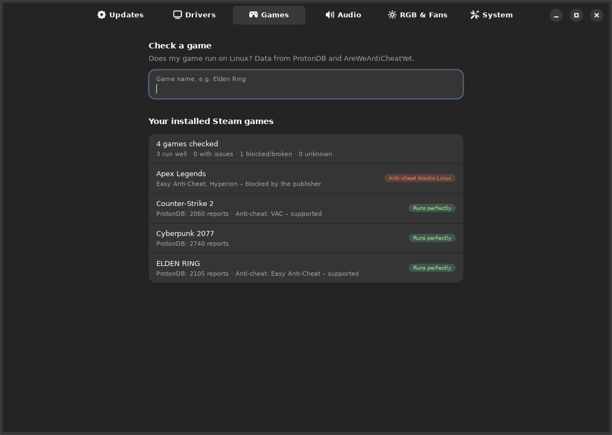
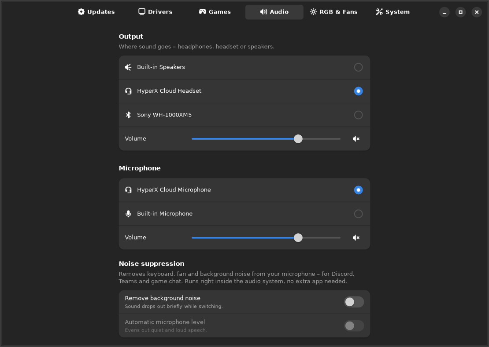
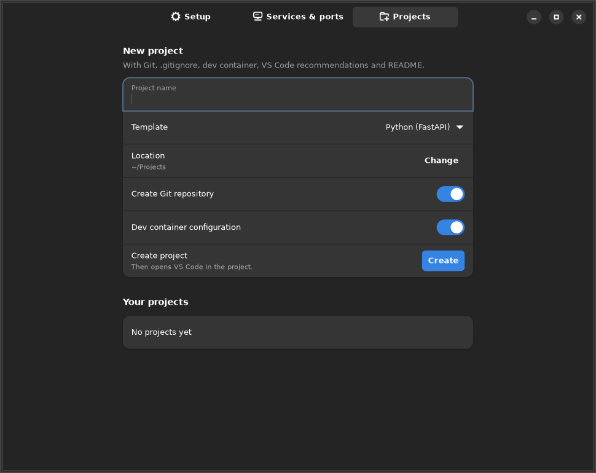

<div align="center">


[](https://github.com/ChopstickGuy/frametide-os/actions/workflows/build-iso.yml)
[](LICENSE)
[](https://ubuntu.com)
[](#status)

[Download](https://sourceforge.net/projects/frametide-os/files/) ·
[Screenshots](#screenshots) ·
[What's included](#whats-included) ·
[Build](#build-it-yourself) ·
[Deutsch](README.de.md)

</div>

Frametide OS is Ubuntu 26.04 LTS with GNOME 50, set up for playing games and writing code.
It handles the things you'd normally do by hand after installing: graphics drivers, Steam,
fan and RGB control, a dev toolchain, and a few small apps that keep all of it in one place.

Under the hood it's still Ubuntu, so you get Ubuntu's packages, documentation and five years of
updates.

## What's different from stock Ubuntu

- **Drivers on first boot.** NVIDIA, AMD and Intel GPUs are detected and set up in the
  background, including the 32-bit libraries Steam needs and hybrid laptop graphics.
- **Gaming stack included.** Steam, Proton, GameMode, MangoHud and Gamescope come pre-installed.
  `ntsync`, larger shader caches and flat mouse acceleration are switched on.
- **Tuned, but nothing exotic.** zram, a per-drive I/O scheduler, `preempt=full`, `noatime`,
  BBR and higher file limits. Updates run at idle priority.
- **No Snap and no telemetry.** Apps come from apt and Flathub.
- **Window layouts.** Drag a window to the top edge and pick a layout (from Ubuntu 26.10).
- **Updates without reinstalling.** Frametide's own apps and settings update through
  *Control → Updates*; a short "What's new" window shows what changed.
- **Quick boot.** The boot menu is hidden, boot doesn't wait for the network, and a quiet
  splash screen shows while it starts.
- **Calm desktop.** Dark GNOME with a teal accent, a fixed dock, a classic applications menu,
  app folders, soft low system sounds and a wave-shaped loading cursor.
- **10 languages offline.** English, German, French, Spanish, Italian, Polish, Portuguese,
  Dutch, Turkish and Russian.

## The apps

| | |
|---|---|
| **App Store** | About 150 hand-picked apps with their real icons, plus search across all of Flathub. Sources are apt, Flathub, ArtCraft and a few vendor packages. |
| **Control** | Updates (system, Flatpak, ArtCraft, firmware), GPU drivers incl. optional latest Mesa, **game check** (ProtonDB + anti-cheat status), **audio**, RGB & fans, and performance options. |
| **Develop** | Git, SSH key and GitHub sign-in; language runtimes via `mise`; PostgreSQL, MySQL, Redis and others as local containers; a live list of dev-server ports; a project starter with templates. |
| **PC Move** | Copies documents, photos, browser bookmarks, Wi-Fi networks and Steam games over from a Windows drive. Windows itself is only read, never changed. |
| **Bench** | A repeatable benchmark (CPU, memory, latency, SSD, GPU, boot time) with JSON output you can compare. |
| **Tasks** | A task manager on <kbd>Ctrl</kbd>+<kbd>Shift</kbd>+<kbd>Esc</kbd>. |

The audio page lets you pick headset, speakers or microphone, set volume, test your mic, and
turn on **noise suppression**. It runs inside PipeWire (WebRTC), so it works in Discord, Teams
and games without an extra app.

## Screenshots

<table>
<tr>
<td width="50%"><p align="center"><sub>App Store</sub></p></td>
<td width="50%"><p align="center"><sub>Control → Games</sub></p></td>
</tr>
<tr>
<td width="50%"><p align="center"><sub>Control → Audio</sub></p></td>
<td width="50%"><p align="center"><sub>Develop → Projects</sub></p></td>
</tr>
</table>

<details>
<summary>Logo and wallpapers</summary>
<br>

</details>

## What's included

| | |
|---|---|
| **Base** | Ubuntu 26.04 LTS, HWE kernel, GNOME 50, Mesa |
| **Gaming** | Steam, Proton, GameMode, MangoHud, Gamescope, Lutris |
| **Office** | ArtCraft: WordCraft, GridCraft, DeckCraft, PdfCraft |
| **Development** | GitHub Desktop, GitHub CLI, mise, Podman, Distrobox |
| **Media** | Video codecs (GStreamer libav/ugly/bad, FFmpeg) |
| **Hardware** | OpenRGB, CoolerControl, lm-sensors, fwupd |
| **Phone** | GSConnect – pair with the KDE Connect app on Android or iOS |
| **Installed on first boot** | Google Chrome and VS Code, directly from Google and Microsoft (their licenses don't allow shipping them on the ISO) |
| **Installer** | Calamares; works offline, BIOS and UEFI with Secure Boot |

## Try it

1. Download the ISO from [SourceForge](https://sourceforge.net/projects/frametide-os/files/).
   Builds from `main` are under
   [Actions → Build ISO → Artifacts](https://github.com/ChopstickGuy/frametide-os/actions/workflows/build-iso.yml).
2. Check it: `sha256sum -c frametide-os-*.iso.sha256`
3. Try it in a VM first (UEFI, 8 GB RAM, 40 GB disk), or write it to a USB stick with
   [Ventoy](https://www.ventoy.net) or [Impression](https://flathub.org/apps/io.gitlab.adhami3310.Impression).
   In the installer, **Erase disk** is the simplest option.

## Status

This is **alpha** software. Every build is installed and booted in QEMU (UEFI and BIOS)
by CI, but it hasn't seen much real hardware yet. Please don't put it on a machine you depend on.

Known limitations:

- Windows stores Wi-Fi passwords encrypted. PC Move can only bring them over if they were
  exported first (`netsh wlan export profile key=clear`).
- VRR is turned on per monitor under *Settings → Displays*.
- RGB and fan control cover what OpenRGB and CoolerControl support. That's most hardware,
  but not all of it.
- Some multiplayer games block Linux through their anti-cheat. The game check shows which ones.

How it compares to CachyOS, Bazzite, SteamOS and others: [docs/COMPARISON.md](docs/COMPARISON.md).

## Useful bits

```bash
frametide-hwsetup                 # show detected hardware and planned steps
sudo frametide-hwsetup --apply    # set up drivers again, e.g. after a GPU swap
cat /var/log/frametide-hwsetup.log
```

- Steam launch option: `gamemoderun %command%`, with an FPS overlay `gamemoderun mangohud %command%`
- Proton-GE: ProtonPlus from the App Store
- Options live in `/etc/frametide/hwsetup.conf` (or Control → System), e.g.
  `AMD_OVERDRIVE=yes` to unlock overclocking/undervolting on AMD graphics

## Build it yourself

```bash
sudo apt install debootstrap squashfs-tools xorriso dosfstools mtools curl librsvg2-bin
python3 tools/check-packages.py   # checks package names against the Ubuntu archive
sudo ./build.sh                   # → out/frametide-os-1.0-ignition-amd64.iso (~25 GB free space)
```

<details>
<summary>Repository layout</summary>

```
config/frametide.conf        name, version, Ubuntu base, languages
build.sh                     debootstrap → chroot → squashfs → ISO (BIOS + UEFI/Secure Boot)
scripts/chroot-install.sh    package installation inside the image
packages/                    Frametide .deb packages (build-debs.sh)
  frametide-base             tuning, boot, zram, sysctl, branding
  frametide-hwsetup          hardware and driver detection
  frametide-gaming           gaming stack
  frametide-desktop          GNOME settings, wallpapers, sounds, cursor, boot splash
  frametide-tools            App Store, Control, Develop, PC Move, Bench, Welcome
  frametide-hardware         OpenRGB, CoolerControl, sensors
  frametide-apps             default apps, Chrome/VS Code on first boot
  frametide-live             live session and Calamares installer
artwork/                     logos (SVG) and generators for wallpapers, sounds, cursor, splash
po/                          translations (tools/i18n.py)
tools/                       package check, CI install test, icon fetcher, i18n
```
</details>

## Contributing

Bug reports, ideas and translations are welcome – see [CONTRIBUTING.md](CONTRIBUTING.md) and the
[issue templates](https://github.com/ChopstickGuy/frametide-os/issues/new/choose).
A new language is one file in `po/`.

## License

Frametide's own code and artwork are licensed under the [GNU GPL v3](LICENSE). Bundled programs
keep their own licenses.

<sub>Frametide OS is an independent community project and isn't affiliated with Canonical, Valve,
Google, Microsoft or the ArtCraft team. Ubuntu is a trademark of Canonical Ltd. All other
trademarks belong to their owners.</sub>
