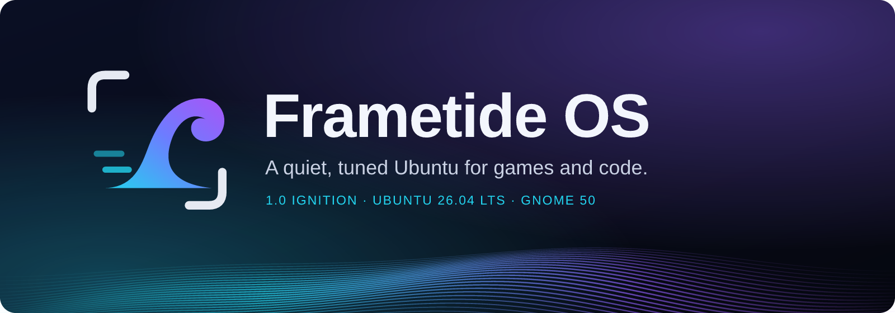
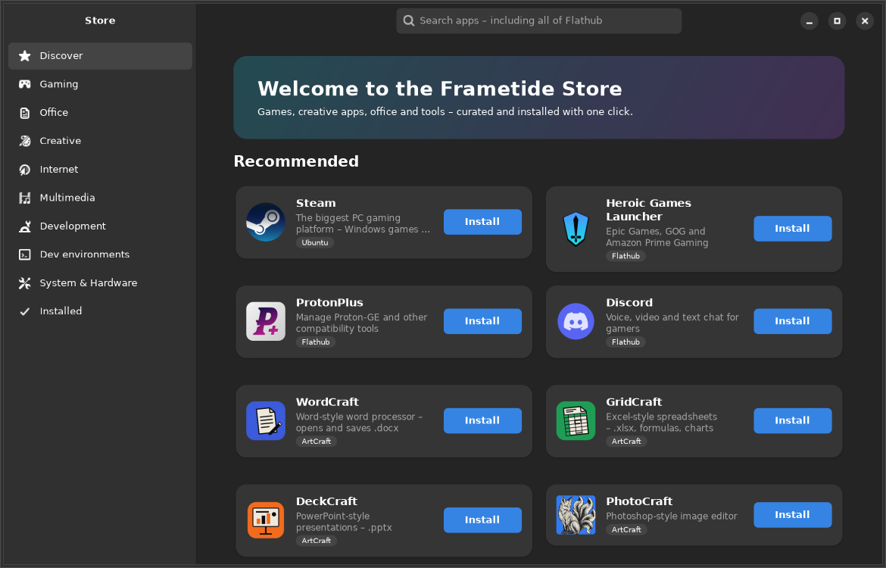
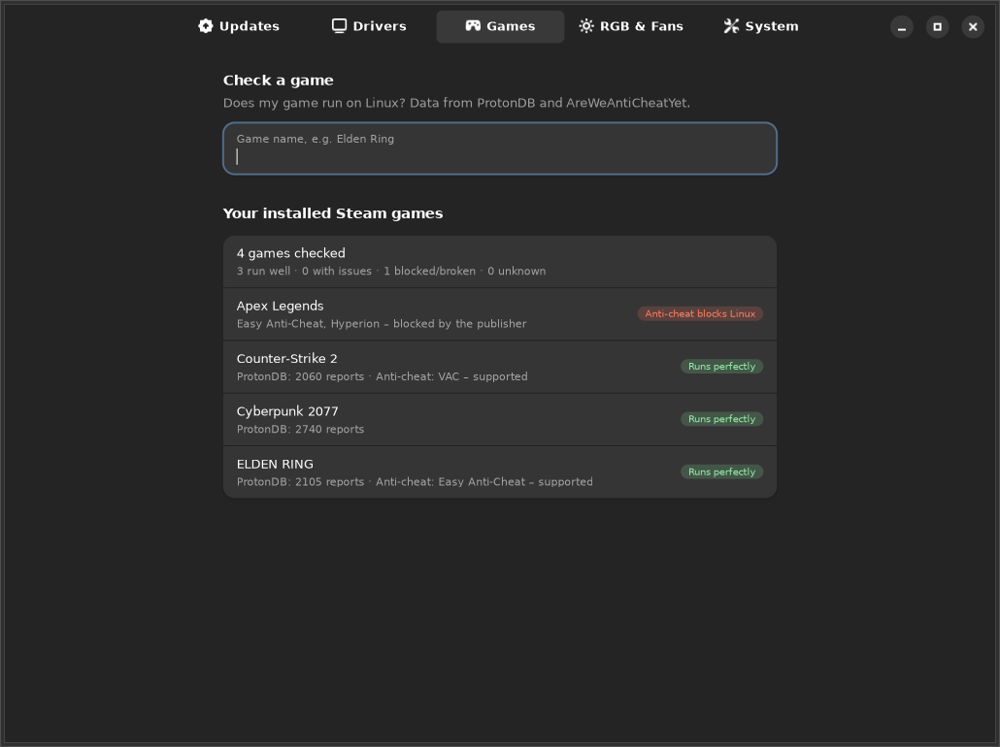
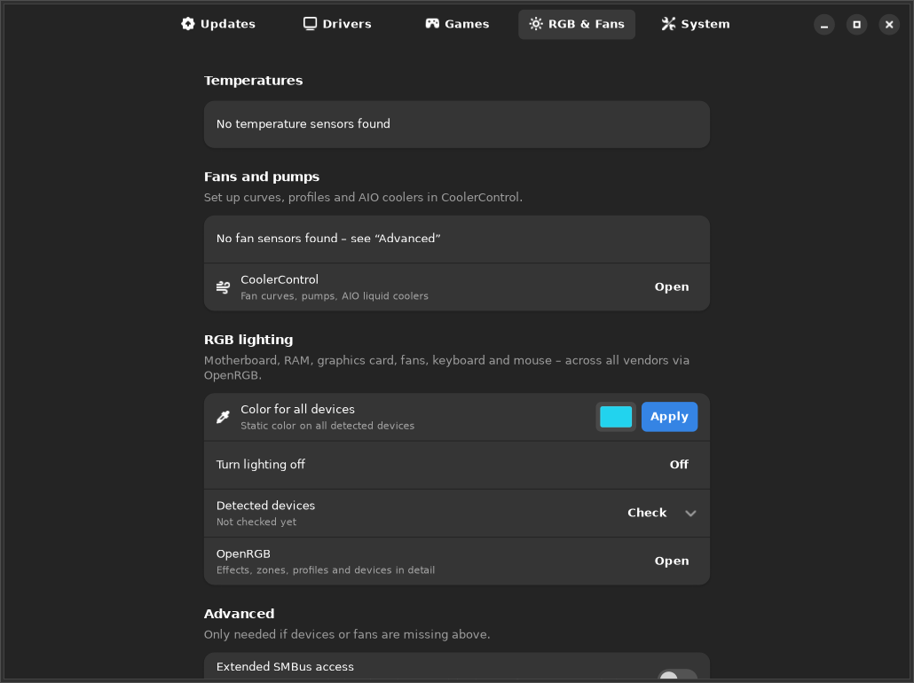
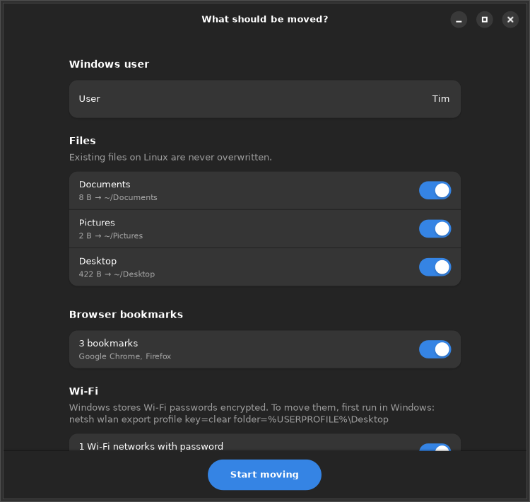
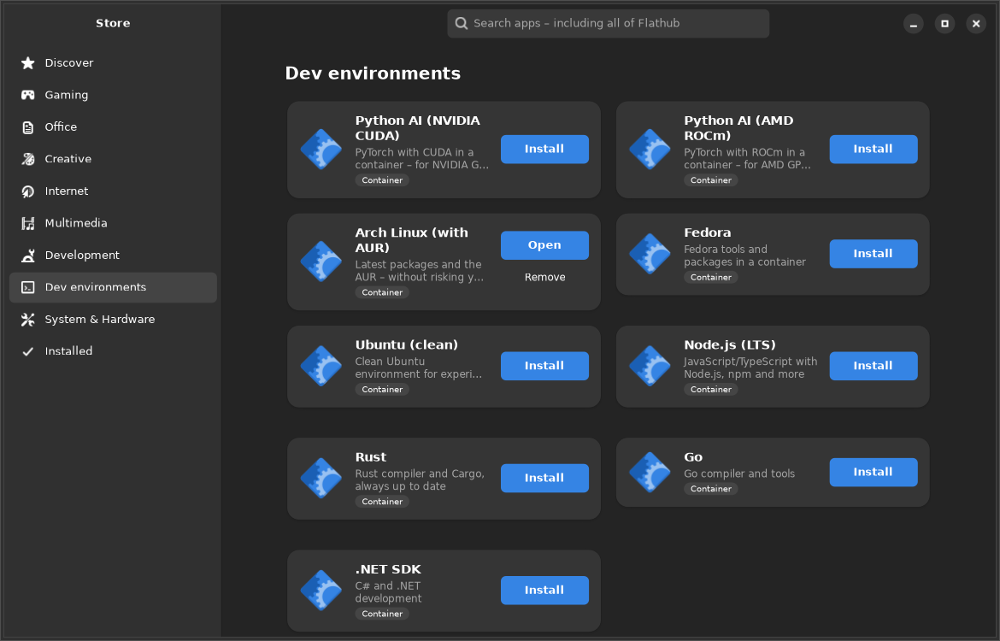
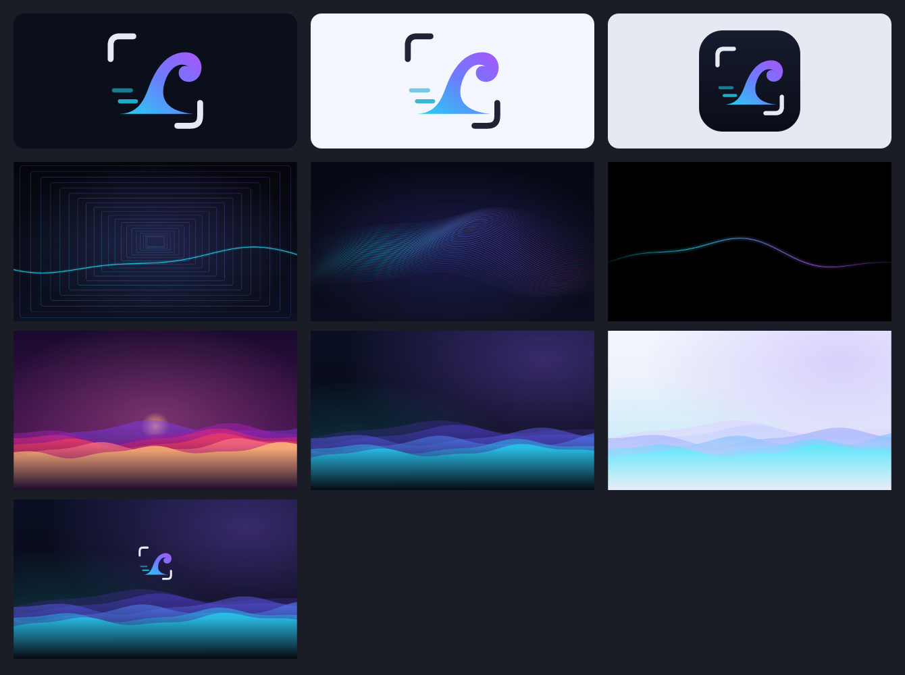

<div align="center">



[](https://github.com/ChopstickGuy/frametide-os/actions/workflows/build-iso.yml)
[](LICENSE)
[](https://ubuntu.com)
[](https://www.gnome.org)
[](#-project-status)
[](https://sourceforge.net/projects/frametide-os/files/)

**A Linux distribution for gamers, creators and developers that just works –<br>
drivers, RGB and fans included, no terminal required.**

[**Download**](https://sourceforge.net/projects/frametide-os/files/) ·
[Features](#-features) ·
[Screenshots](#-screenshots) ·
[Comparison](docs/COMPARISON.md) ·
[Build it yourself](#-build-it-yourself) ·
[Deutsch](README.de.md)

</div>

---

## Why Frametide?

Most gaming distros are built for Linux enthusiasts (CachyOS), one specific piece of
hardware (SteamOS) or pure gaming (Bazzite). **Frametide is built for people who are leaving
Windows** and want to keep everything working: games, office work and their hardware.

<table>
<tr>
<td width="33%" valign="top">

### 🎮 Hardware that just works
Your graphics driver is set up on first boot: NVIDIA, AMD or Intel, including Secure Boot
**without MOK enrollment**. RGB lighting and fan curves for almost every vendor are
managed from one app.

</td>
<td width="33%" valign="top">

### 🧰 Everything from day one
Steam, Proton, GameMode and MangoHud are pre-installed. The **ArtCraft** suite gives you
Word-, Excel-, PowerPoint- and PDF-style apps. Chrome, VS Code and GitHub Desktop are ready
after the first boot.

</td>
<td width="33%" valign="top">

### 🛡️ Stable, yet tuned
Built on Ubuntu 26.04 LTS with **5 years of updates**. On top come low-latency kernel
settings, `ntsync` for Proton, zram and a calm, minimal GNOME desktop.

</td>
</tr>
</table>

## ✨ Features

| | |
|---|---|
| **🚀 Zero-touch drivers** | `frametide-hwsetup` detects every GPU and installs the right driver, the 32-bit libraries for Steam, kernel parameters and hybrid-graphics support. It runs in the background and never slows down boot. |
| **🛒 Frametide Store** | 95 hand-picked apps with real logos, a search across all of Flathub, and one-click **dev environments** (Python AI with CUDA/ROCm, Arch with AUR, Node.js, Rust, Go, .NET) in containers. |
| **🎛️ Frametide Center** | One place for updates (system, Flatpak, ArtCraft, firmware), GPU drivers including the NVIDIA version picker, **RGB & fans** and performance options. |
| **🕹️ Game check** | Shows for every Steam game whether it runs on Linux (ProtonDB) and whether **anti-cheat blocks it** (AreWeAntiCheatYet). This works for games you don't own yet, too. |
| **🪟 Move from Windows** | Brings over your documents, photos, bookmarks (Chrome, Edge, Firefox …), Wi-Fi networks and installed Steam games, so they don't need to be downloaded again. Windows itself is only read, never changed. |
| **📊 Frametide Bench** | A reproducible benchmark for CPU, memory, latency under load, SSD, GPU and boot time. Its JSON results can be compared against any other system. |
| **🧭 Clear, classic desktop** | GNOME with a classic categorized *Applications* menu, an always-visible dock with your key apps, and app folders instead of an endless icon wall. A welcome screen on first login shows you around. |
| **⚡ Fast & quiet** | Hidden boot menu, no waiting for the network, no Snap, no telemetry. Updates run with idle priority so they never steal frames. |
| **🎹 Synthwave sound theme** | Custom retro-modern system sounds and a startup jingle made with analog-style synths, arpeggios and echo. |
| **🌍 10 languages offline** | German, English, French, Spanish, Italian, Polish, Portuguese, Dutch, Turkish and Russian. |

## 📸 Screenshots

<table>
<tr>
<td><p align="center"><b>Frametide Store</b></p></td>
<td><p align="center"><b>Game check</b></p></td>
</tr>
<tr>
<td><p align="center"><b>RGB &amp; fans</b></p></td>
<td><p align="center"><b>Move from Windows</b></p></td>
</tr>
<tr>
<td colspan="2"><p align="center"><b>One-click dev environments</b></p></td>
</tr>
</table>

<details>
<summary><b>Logo, wallpapers and design</b></summary>
<br>


The design is a dark GNOME 50 with a teal accent, Inter and JetBrains Mono fonts, Papirus
icons, a fixed dock and a classic applications menu. There are seven wallpapers, including a light/dark pair that
follows the system theme.
</details>

## 📦 What's inside

| Area | Details |
|---|---|
| **Base** | Ubuntu 26.04 LTS, HWE kernel 7.0 (signed, keeps up with new hardware), GNOME 50, Mesa 26 |
| **Gaming** | Steam, Proton, GameMode, MangoHud, Gamescope, Lutris, `ntsync`, large shader caches, flat mouse acceleration |
| **Pre-installed** | ArtCraft (WordCraft, GridCraft, DeckCraft, PdfCraft, Launcher), GitHub Desktop, GitHub CLI, OpenRGB, CoolerControl, Firefox. Chrome and VS Code are installed on first boot from Google and Microsoft. |
| **Tuning** | zram (zstd), I/O scheduler per drive type, `preempt=full`, `noatime`, THP `defer+madvise`, BBR, higher file limits, "Performance" power profile on desktops |
| **Installer** | Calamares, six simple steps, works offline, BIOS and UEFI with Secure Boot |

## 💿 Try it

1. Download the ISO from [**SourceForge**](https://sourceforge.net/projects/frametide-os/files/).
   Builds from `main` are also available under
   [Actions → Build ISO → Artifacts](https://github.com/ChopstickGuy/frametide-os/actions/workflows/build-iso.yml).
2. Verify it: `sha256sum -c frametide-os-*.iso.sha256`
3. Test it in a VM (GNOME Boxes or VirtualBox with **UEFI**, 8 GB RAM, 40 GB disk), or write it to a USB
   drive with [Ventoy](https://www.ventoy.net) or [Impression](https://flathub.org/apps/io.gitlab.adhami3310.Impression).

## 🧪 Project status

Frametide OS is **alpha software**. Please try it in a VM or on a spare machine first.
Every build is booted automatically in QEMU (UEFI and BIOS) before it is published.
Known limitations:

- Wi-Fi passwords can only be moved from Windows if they were exported there first
  (`netsh wlan export profile key=clear`), because Windows stores them encrypted.
- VRR is switched on per monitor in GNOME 50 under *Settings → Displays*.
- RGB and fan control cover what OpenRGB and CoolerControl support. That is most of the
  market, but not every device.

Planned next: snapshots before every update, a Steam Big Picture "Game Mode" session, and
`sched_ext` schedulers. See [docs/COMPARISON.md](docs/COMPARISON.md) for the full roadmap.

## 🔧 Build it yourself

```bash
sudo apt install debootstrap squashfs-tools xorriso dosfstools mtools curl librsvg2-bin
python3 tools/check-packages.py   # checks every package name against the Ubuntu archive
sudo ./build.sh                   # → out/frametide-os-1.0-ignition-amd64.iso (about 25 GB free space needed)
```

<details>
<summary><b>Repository layout</b></summary>

```
config/frametide.conf        name, version, Ubuntu base, languages, pre-installed ArtCraft apps
build.sh                     ISO build: debootstrap → chroot → squashfs → ISO (BIOS + UEFI/Secure Boot)
scripts/chroot-install.sh    package installation inside the image
packages/                    Frametide packages (.deb), built with build-debs.sh
  frametide-base             tuning, boot speed, zram, sysctl, I/O, branding
  frametide-hwsetup          hardware and driver detection
  frametide-gaming           gaming stack and GameMode profile
  frametide-desktop          GNOME design, wallpapers, sounds
  frametide-tools            Store, Center, game check, Move from Windows, Bench
  frametide-hardware         OpenRGB, CoolerControl, sensors
  frametide-apps             default apps, Chrome/VS Code on first boot
  frametide-live             live session and Calamares installer
artwork/                     logos (SVG), generators for wallpapers and sounds
po/                          translations (tools/i18n.py)
tools/                       package check, icon fetcher, ArtCraft downloader, i18n
```
</details>

## 🤝 Contributing

Bug reports, ideas and translations are very welcome. Please read [CONTRIBUTING.md](CONTRIBUTING.md)
and use the [issue templates](https://github.com/ChopstickGuy/frametide-os/issues/new/choose).
Adding a language just takes one file in `po/`.

## 📄 License

The Frametide OS code (scripts, packages, Store, Center, artwork) is licensed under the
**[GNU GPL v3](LICENSE)**. Bundled programs keep their own licenses. For that reason Google
Chrome and Visual Studio Code are not shipped on the ISO; they are installed on first boot
directly from Google and Microsoft.

<sub>Frametide OS is an independent community project. It is not affiliated with Canonical (Ubuntu), Valve (Steam),
Google, Microsoft or the ArtCraft team. All trademarks belong to their respective owners.</sub>
